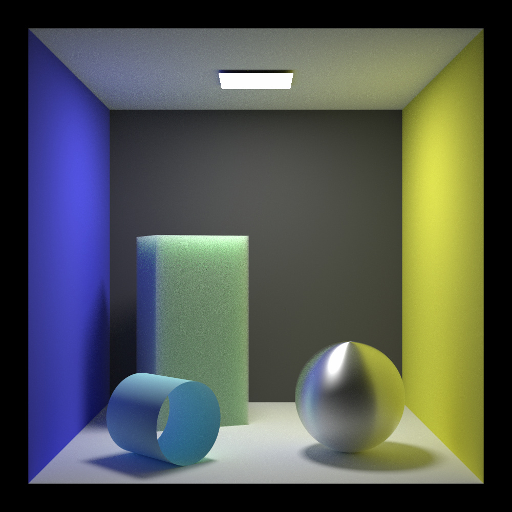
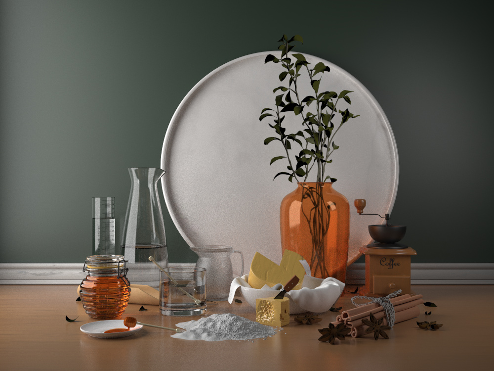

# Liminar
***Liminal space Renderer***

## Features

## Dependencies
- [tinyobjloader](https://github.com/tinyobjloader/tinyobjloader.git)
- [tinygltf](https://github.com/syoyo/tinygltf)
- [stb](https://github.com/nothings/stb/tree/master)
- OpenMP

## Build
**MacOS**
```sh
git clone git@github.com:Goomasa/liminar.git

cmake . -B build -DCMAKE_BUILD_TYPE=Release
cmake --build build
```

**Windows (Visual Studio Generator)**
```sh
cmake . -B build 
cmake --build build --config Release
```

## Gallery



    
> Model: [Cannelle & Fromage](https://github.com/LuxCoreRender/LuxCoreTestScenes) by Charles Nandeya Ehouman (Sharlybg)

> GLB version used: obtained from [StokastX/Nexus](https://github.com/StokastX/Nexus)

## References
- Dupuy, Jonathan, and Anis Benyoub. "Sampling visible GGX normals with spherical caps." Computer Graphics Forum. Vol. 42. No. 8. 2023.
- Karis, Brian, and Epic Games. "Real shading in unreal engine 4." Proc. Physically Based Shading Theory Practice 4.3 (2013): 1.
- https://rayspace.xyz/CG/
